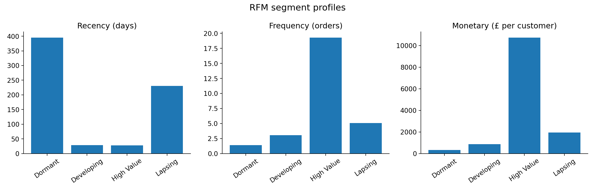
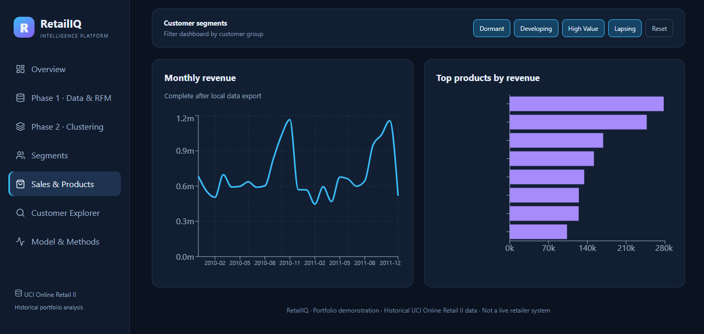

# RetailIQ — Customer Segmentation & Revenue Intelligence

**From raw retail transactions to interpretable customer segments and an interactive business intelligence dashboard.**

RetailIQ is an end-to-end data science portfolio project using the **UCI Online Retail II (2009–2011)** dataset. It demonstrates transaction cleaning, RFM feature engineering, unsupervised machine learning, diagnostic visualization, customer profiling, and an interactive **Next.js / Recharts** dashboard.

> **Scope:** Retrospective analysis of *positive-purchase revenue* in GBP. Returns/cancellations were excluded, so reported revenue is **not net accounting revenue**. This is a portfolio demonstration, not a live retailer system.

## Executive summary

The analysis covers **5,878 identifiable customers** and approximately **£17.37 million** in historical positive-purchase revenue. The most striking result is that **1,196 customers (20.35%) account for 73.87% of that revenue**.

**Why it matters:** The retailer's revenue is highly concentrated. Retention and account management for this segment may be important, but high historical spend alone does **not** establish future lifetime value or justify discounts. Some customers may be wholesale buyers.


*Figure 1 — Customer share versus revenue share. The High Value segment contributes a disproportionate share of historical revenue. Percentages describe the observed data, not causal marketing effects.*

### Key business takeaways

1. **Revenue concentration:** High Value customers account for **20.35% of customers** but **73.87% of revenue**. Investigate their product mix, purchasing consistency, and potential wholesale status.
2. **Dormancy at scale:** **33.57%** of customers belong to the Dormant segment but contribute only **3.60%** of revenue. A low-cost reactivation experiment may be more prudent than blanket discounts.
3. **A reactivation candidate:** Lapsing customers represent **24.82%** of customers and **16.36%** of revenue. They previously purchased more often than Dormant customers but have not purchased recently.
4. **A growth candidate:** Developing customers have recent purchasing activity but lower order frequency and spend. Test whether useful recommendations or follow-up communications increase repeat purchases.

## Dataset and pipeline

**Source:** [UCI Online Retail II](https://archive.ics.uci.edu/dataset/502/online+retail+ii), transactional records from a UK-based retailer across 2009–2011.

```text
Two Excel worksheets
       ↓
Combine and standardize columns
       ↓
Drop duplicates, missing CustomerID, cancellations,
nonpositive quantities and prices
       ↓
Revenue = Quantity × UnitPrice
       ↓
Aggregate by CustomerID → RFM
       ↓
log1p(RFM) → StandardScaler → K-Means
       ↓
Evaluate K, profile segments, visualize in dashboard
```

**RFM features**

| Feature | Definition | Interpretation |
|---|---|---|
| **Recency** | Days between snapshot date and customer's latest purchase | Lower means a more recent purchase |
| **Frequency** | Count of distinct positive-purchase invoices | Higher means more observed orders |
| **Monetary** | Sum of positive-purchase line revenue | Higher means more historical spend |

The RFM snapshot was taken after the final transaction in the available dataset. Customer tenure varies; a customer observed for two years has more opportunity to accumulate orders than a new customer.

## Phase 1 — Descriptive customer analytics

The cleaned dataset is transformed into one row per customer. This supports consistent comparisons of purchasing behavior rather than comparisons of individual invoice lines.

### What the features tell us

- **Recency** can flag prolonged inactivity, but is not itself a verified churn label.
- **Frequency** helps distinguish occasional buyers from repeat purchasers.
- **Monetary** reveals spending concentration, but can be distorted by unusually large orders or wholesale activity.



*Figure 2 — Average RFM behavior by segment. High Value customers purchase much more frequently and spend substantially more. Dormant and Lapsing customers differ notably in historical frequency and time since last purchase. Different panels use different units; compare within each panel.*

## Phase 2 — K-Means customer segmentation

The pipeline applies `log1p` to Recency, Frequency, and Monetary to reduce skew, then standardizes the features before fitting K-Means. Candidate cluster counts **K = 2 through K = 10** were evaluated using inertia and silhouette scores.

### Model selection: separation versus interpretability



*Figure 3 — Approximate silhouette values transcribed from the earlier evaluation plot, **not exact scores exported from the model**. K=2 (~0.440) scores higher than K=4 (~0.365). The four-cluster solution was chosen to explore more actionable descriptive profiles, not because it was statistically optimal.*

**Interpretation:** A higher silhouette score indicates better separation under that metric. Choosing four groups trades some separation for finer-grained business descriptions. This choice still needs stability checks and prospective validation.

> **Original diagnostic images:** If available, copy `outputs/cluster_evaluation.png` and `outputs/customer_clusters_pca.png` from the Python project into `docs/images/`. The PCA scatter plot is a **2D projection** of standardized RFM features; overlapping points do not automatically invalidate the clustering.

### Four observed segments

| Segment | Customers | Customer share | Revenue (£) | Revenue share | Avg. recency (days) | Avg. orders | Avg. spend (£) |
|---|---:|---:|---:|---:|---:|---:|---:|
| **Dormant** | 1,973 | 33.57% | 625,601.80 | 3.60% | 394.95 | 1.38 | 317.08 |
| **Developing** | 1,250 | 21.27% | 1,071,864.29 | 6.17% | 28.30 | 3.05 | 857.49 |
| **High Value** | 1,196 | 20.35% | 12,834,470.94 | 73.87% | 27.71 | 19.28 | 10,731.16 |
| **Lapsing** | 1,459 | 24.82% | 2,842,867.24 | 16.36% | 230.07 | 5.06 | 1,948.50 |

*Rounded percentages may not total exactly 100%.*

### Segment-by-segment interpretation

**Dormant — low engagement, long inactivity.** Customers have not purchased for about **395 days** on average and have made **1.38 orders** on average. This is a large customer group with little observed revenue. **Hypothesis to test:** inexpensive win-back messaging may work for a subset, but costly discounts could be uneconomic.

**Developing — recent, moderate engagement.** Customers purchased about **28 days** ago on average and made **3.05 orders**. **Hypothesis to test:** personalized follow-ups or product discovery could increase repeat purchase rates.

**High Value — recent, frequent, revenue-concentrated.** Customers made **19.28 orders** and spent about **£10,731** on average during the observation period. The segment contributes **£12.83 million** of observed revenue. **Priority investigation:** determine whether wholesale-like accounts or outliers drive these totals, and measure customer concentration risk.

**Lapsing — previously engaged, now less recent.** Customers made **5.06 orders** on average but have an average recency of **230 days**. **Hypothesis to test:** targeted reactivation could be more promising than contacting uniformly dormant accounts.

These are **descriptive names**, not verified churn states, causal effects, or predictions.

## Interactive dashboard

The dashboard uses **Next.js, React, and Recharts** to present customer KPIs, segment comparisons, sales trends, and model explanations.


*Figure 4 — Screenshot of the Sales & Products page during development. It shows monthly revenue and ranked products. Product-name labels were being refined at the time of capture; this is not presented as a final production screenshot.*

**Included sections:** Overview; Phase 1 Data & RFM; Phase 2 Clustering; Segments; Sales & Products; Customer Explorer; Model & Methods.

The deployed dashboard reads a **static exported analytics snapshot**. It does not run K-Means training or a live Python API on Vercel.

## Repository structure

Recommended organization when combining the original Python project with the Next.js website:

```text
RetailIQ/
├── README.md
├── docs/
│   └── images/
│       ├── revenue_concentration.png
│       ├── rfm_profiles.png
│       ├── silhouette_approx.png
│       └── dashboard-sales-screenshot.png
├── src/                        # Python scripts: exploration → clustering
├── data/                       # Local-only datasets (do not publish)
├── outputs/                    # Generated analyses (review before publishing)
└── dashboard/
    ├── app/
    ├── public/
    ├── scripts/
    └── package.json
```

## Run locally

### Python analytics

Use Python 3.12 or a compatible environment and install the dependencies required by your existing scripts:

```powershell
python -m pip install pandas numpy openpyxl pyarrow matplotlib seaborn scikit-learn
```

Place the UCI workbook in the `data/` location expected by your scripts, then run the analysis pipeline from the repository root, for example:

```powershell
python src/01_explore.py
python src/02_clean.py
python src/03_rfm.py
python src/04_segmentation.py
```

The Python pipeline generates `data/clean_transactions.parquet` and `outputs/customer_segments.csv`. Additional business analysis scripts may also be present.

### Next.js dashboard

From `dashboard/`:

```powershell
npm install
python scripts/export.py --project "C:\path\to\your\RetailIQ"
Copy-Item ".\data\analytics.json" ".\public\retailiq-data.json" -Force
npm run dev
```

Open `http://localhost:3000`. Check that the JSON field names match the dashboard code. Run `npm run build` before deploying.

**Public-data warning:** The exported dashboard JSON may include customer-level IDs and records. **Review and sanitize it before committing or deploying publicly.** Do not assume pseudonymous IDs are risk-free.

## Limitations

- **Positive purchases only:** Refunds and cancellations were excluded; revenue is not net sales.
- **Possible wholesale customers:** Large orders may dominate the High Value segment.
- **Retrospective clustering:** RFM values use the full observed period and do not constitute prospective predictions.
- **Unequal observation windows:** Customers have different tenure in the dataset.
- **Model selection trade-off:** K=2 achieved a higher silhouette score than K=4.
- **Unvalidated business interventions:** Recommendations are hypotheses, not measured campaign lift.
- **Temporal coverage:** The final month is incomplete.

## Roadmap

- **Phase 3A — Business intelligence:** Refine dashboard charts, filtering, and model diagnostics.
- **Phase 3B — Customer lifetime value:** Evaluate BG/NBD and, where assumptions hold, Gamma-Gamma with time-based validation.
- **Phase 3C — Inactivity prediction:** Compare logistic regression and LightGBM with chronological holdouts and probability calibration.
- **Phase 3D — Marketing optimization:** Use randomized experiments where possible; otherwise clearly label simulations and avoid treating propensity as uplift.

## Tech stack

**Analytics:** Python, Pandas, NumPy, scikit-learn, Matplotlib, PyArrow.  
**Dashboard:** Next.js, React, Recharts.  
**Deployment:** Vercel (static exported analytical snapshot).

## Dataset credit

UCI Machine Learning Repository — **Online Retail II**. Consult the [dataset record](https://archive.ics.uci.edu/dataset/502/online+retail+ii) for citation details and applicable usage conditions.
